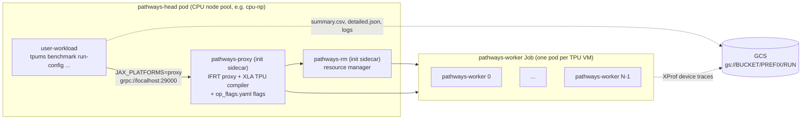

# TPUMS on Pathways on Cloud — launcher

This directory runs TPUMS configs on
[Pathways on Cloud](https://cloud.google.com/ai-hypercomputer/docs/workloads/pathways-on-cloud/pathways-intro)
(GKE). It is the Pathways counterpart of the McJAX launcher
(`cloud_launch/xpk_launch.sh` + `common.sh`): instead of `xpk workload create`,
which starts one TPUMS process per TPU VM, it builds a **Pathways JobSet** with
the `PathwaysJobSet` generator from
[pathways-utils](https://github.com/AI-Hypercomputer/pathways-utils)
(`pathwaysutils.experimental.gke.jobset`) and runs a single TPUMS client next to
the Pathways resource manager and proxy.

See [`docs/PATHWAYS.md`](../../docs/PATHWAYS.md) for how TPUMS itself behaves on
Pathways (what changed, what the numbers mean, and the current limitations).

| File | Purpose |
| :--- | :--- |
| [`common.sh`](common.sh) | Shared settings (project, cluster, TPU slice, Pathways release, images, GCS, Kueue). All overridable via environment variables. |
| [`build_image.sh`](build_image.sh) + [`Dockerfile`](Dockerfile) | Builds and pushes the TPUMS client image from this checkout (`tpums-pathways:<git sha>-<date>`). |
| [`generate_workload.py`](generate_workload.py) | Generates the JobSet YAML with `PathwaysJobSet` (optionally applies it). |
| [`pathways_launch.sh`](pathways_launch.sh) | End-to-end launcher: cleanup → generate → `kubectl apply` → wait → print log. |
| [`run_benchmark.sh`](run_benchmark.sh) | Entrypoint of the `user-workload` container: runs `tpums benchmark run-config` and uploads results. |
| [`upload_results.py`](upload_results.py) | Copies the results directory to GCS with `tf.io.gfile` (no gcloud in the image). |
| [`requirements.txt`](requirements.txt) | Launcher dependencies (`pathwaysutils[gke]` pinned to a GitHub commit). |
| [`generate_workload_test.py`](generate_workload_test.py) | Unit tests for the generator (no cluster needed). |

## What gets deployed



`generate_workload.py` starts from `PathwaysJobSet(...)` and then:

1. **`add_user_workload()`** adds the TPUMS container to the head pod. The
   generator moves `pathways-rm`/`pathways-proxy` to native-sidecar init
   containers, sets `JAX_PLATFORMS=proxy`,
   `JAX_BACKEND_TARGET=grpc://localhost:29000`, and makes the JobSet succeed
   when TPUMS exits 0.
2. **Op flags → proxy.** The benchmark's `op_flags.yaml` `flags` are TPU
   *compilation* flags. On McJAX TPUMS exports them as `LIBTPU_INIT_ARGS` in
   every process; a Pathways client has no libtpu, and compilation happens in
   the `pathways-proxy` container, so they are appended to the proxy args.
   `env` entries (TPU runtime settings, e.g. `TPU_PREMAPPED_BUFFER_SIZE` for the
   host↔device benchmarks) go to the `pathways-worker` containers.
   `--op_flags=none` (or `OP_FLAGS=none`) disables this if a flag is not
   accepted by the proxy build.
3. **Scheduling:** Kueue queue label, `priorityClassName` on head and worker
   pods, head node-pool selector, and `activeDeadlineSeconds` on the head Job
   (default 1800 s, like the Pathways CI workloads). The `user-workload`
   container defaults to 8 CPU / 32G: the client only dispatches work, and a
   smaller head pod leaves CPU node-pool quota for other jobs.
4. **Client settings** passed as env: `TPUMS_CONFIG`, `TPUMS_GCS_OUTPUT_DIR`,
   `TPUMS_XPROF_DIR`, and `TPUMS_PATHWAYS_VERSION` (recorded in
   `runtime_version`). TPUMS also honors `TPUMS_PATHWAYS_STARTUP_TIMEOUT_S` and
   `TPUMS_PATHWAYS_TRACE_START_DELAY_S` (see
   [`docs/PATHWAYS.md`](../../docs/PATHWAYS.md)).

`pathways_launch.sh` uses its own kubeconfig
(`~/.kube/tpums-pathways-<cluster>.yaml`, override with `TPUMS_KUBECONFIG`),
so it neither needs nor changes your current `kubectl` context, and it prints a
Cloud Logging link with the logs of every container of the run.

## Quick start

```bash
cd accelerator-microbenchmarks   # repository root

# 1. Configure (or edit common.sh).
export PROJECT_ID=cloud-tpu-multipod-dev
export CLUSTER_NAME=pw-scale-test-v5e-32 CLUSTER_LOCATION=us-south1
export TPU_TYPE=v5e TOPOLOGY=4x8
export PATHWAYS_VERSION=20261013-jax_0.11.1
export IMAGE_REPOSITORY=us-docker.pkg.dev/cloud-tpu-multipod-dev/pathways-test
export GCS_BUCKET=cloud-pathways-staging GS_PREFIX=tpums-pathways

# 2. Build and push the TPUMS client image (prints the TPUMS_IMAGE to export).
cloud_launch/pathways/build_image.sh
export TPUMS_IMAGE=us-docker.pkg.dev/cloud-tpu-multipod-dev/pathways-test/tpums-pathways:<tag>

# 3. Run a config. Results: gs://$GCS_BUCKET/$GS_PREFIX/<run name>/
cloud_launch/pathways/pathways_launch.sh configs/v5e/4x8/all_gather.yaml
```

To only generate the YAML (e.g. to review or `kubectl apply` it yourself):

```bash
python3 -m venv ~/tpums_pathways_venv
~/tpums_pathways_venv/bin/pip install -r cloud_launch/pathways/requirements.txt
~/tpums_pathways_venv/bin/python cloud_launch/pathways/generate_workload.py \
  --name=tpums-pw-ag \
  --config=configs/v5e/4x8/all_gather.yaml \
  --image="${TPUMS_IMAGE}" \
  --tpu_type=v5e --topology=4x8 \
  --pathways_version=20261013-jax_0.11.1 \
  --pathways_dir=gs://my-bucket/tpums-pathways/tpums-pw-ag/pathways_scratch \
  --gcs_output_dir=gs://my-bucket/tpums-pathways/tpums-pw-ag \
  --xprof_dir=gs://my-bucket/tpums-pathways/tpums-pw-ag/xprof \
  --output=/tmp/tpums-pw-ag.yaml
kubectl apply -f /tmp/tpums-pw-ag.yaml
```

## Outputs

`gs://$GCS_BUCKET/$GS_PREFIX/<run name>/` contains:

| Path | Content |
| :--- | :--- |
| `summary.csv`, `detailed.json` | TPUMS results (same format as McJAX; extra `runtime=pathways` and `runtime_version` columns). |
| `execution.log` | Full TPUMS output. |
| `config.yaml`, `git_commit.txt` | The config that ran and the image's TPUMS commit. |
| `xprof/<benchmark>_<case>_<ts>/plugins/profile/<session>/*.xplane.pb` | XProf traces written by the Pathways client, resource manager and worker(s) (when `ENABLE_XPROF=true`). |
| `pathways_scratch/` | Pathways server scratch space. |

## McJAX (`xpk_launch.sh`) vs Pathways (`pathways_launch.sh`)

| | McJAX | Pathways |
| :--- | :--- | :--- |
| Workload | `xpk workload create` (one JobSet, one TPUMS process per TPU VM) | `PathwaysJobSet` (head pod with RM + proxy + 1 TPUMS client, worker pods with the Pathways server) |
| TPUMS install | `git clone` + `uv pip install .` at pod start | Baked into `tpums-pathways` image from this checkout |
| TPU runtime | `libtpu` wheel in the TPUMS process | Pathways server/proxy images (`PATHWAYS_VERSION`) |
| Op flags | `LIBTPU_INIT_ARGS` in each process | `pathways-proxy` args (flags) / `pathways-worker` env (env) |
| `jax.distributed` | Initialized (multi-controller) | Skipped (single controller) |
| XProf | Local dir, parsed in-process | `gs://` dir only; written by Pathways components |
| Results | Each host writes its own `results/`; host 0's tarball uploaded | One `summary.csv` uploaded by the single client |
